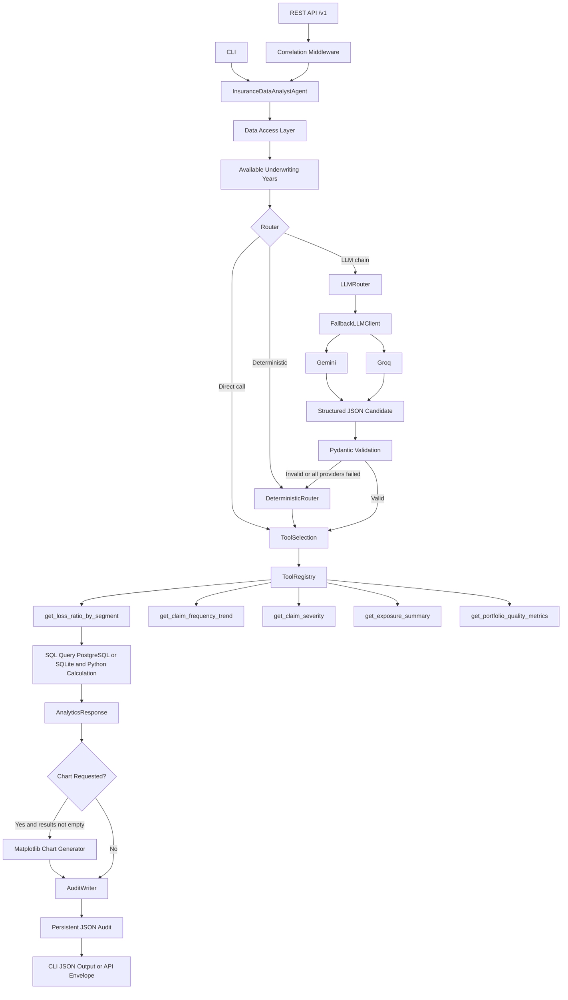

# System Architecture

## Purpose

This document describes the architecture of the **Insurance Data Analyst Agent**.

The application answers selected analytical questions about a synthetic insurance portfolio. It routes a question to an explicitly authorized tool, validates all tool arguments, runs deterministic SQL and Python calculations on PostgreSQL or SQLite, optionally generates a chart, and persists a complete JSON audit artifact. It is available through a CLI and a versioned REST API.

The project demonstrates a controlled analytical-agent design for insurance portfolio exploration. It is not a production underwriting, pricing, claims, reserving, or coverage-determination system. It is Project 2 of a five-project insurance agentic AI portfolio, alongside a submission extractor, a knowledge/RAG agent, an underwriting agent, and a Docker Compose orchestration layer.

## Design Goals

- **Controlled tool use:** the application executes only allow-listed analytical tools.
- **Deterministic calculations:** business metrics are calculated in SQL and Python, not by the LLM.
- **Validated inputs:** tool names, dimensions, years, provinces, and lines of business are validated with Pydantic.
- **Auditability:** every execution records the question, routing result, tool calls, arguments, raw results, response, and errors where applicable.
- **Traceability:** a correlation identifier follows each API request through headers, logs, responses, and chart file names.
- **Reproducibility:** synthetic data is generated from an explicit seed and loaded into PostgreSQL or SQLite.
- **Storage portability:** the same analytical query runs on PostgreSQL and SQLite, and a test checks that both return the same results.
- **Provider independence:** provider-specific SDK code is isolated behind an `LLMClient` contract.
- **Safe fallback:** the deterministic router remains available when every LLM provider fails or returns invalid output.
- **Safe failure:** errors use a uniform envelope and never expose internal details, credentials, or connection strings.
- **Controlled visualization:** charts are generated by Python from approved metadata and analytical results.




The route to a tool is controlled before calculation begins. The LLM may propose a structured tool selection, but it cannot directly execute SQL, Python code, shell commands, arbitrary functions, or external actions.
| Component | Responsibility | Provider-specific |
|---|---|---:|
| `cli.py` | Parses commands (`init-data`, `init-db`, `loss-ratio`, `ask`), builds dependencies, returns JSON or controlled errors | No |
| `api/app.py` | Application factory with injectable settings, router, and data source | No |
| `api/routes.py` | `GET /health`, `POST /v1/analyze`, `POST /v1/loss-ratio` | No |
| `api/schemas.py` | Request and response envelopes, identifier and chart-dimension validation | No |
| `api/middleware.py` | Validates and propagates `X-Correlation-ID` and `X-Request-ID` | No |
| `api/errors.py` | Maps exceptions to the uniform error envelope (422, 503, 500) | No |
| `api/main.py` | ASGI entry point used by Uvicorn and Docker | No |
| `config.py` | Loads validated runtime settings from environment variables | No |
| `logging_config.py` | Configures logs and the correlation identifier context | No |
| `database.py` | Retrieves controlled metadata (available underwriting years) | No |
| `infrastructure/persistence/access.py` | Resolves a SQLite path or an SQLAlchemy engine into a connection, and describes it safely | No |
| `infrastructure/persistence/database.py` | Builds engines and sessions, normalizes URLs, runs Alembic migrations | No |
| `infrastructure/persistence/models.py` | Declares the `policies`, `exposure`, and `claims` tables | No |
| `infrastructure/persistence/migrations/` | Alembic environment and versioned schema migrations | No |
| `models/analytics.py` | Defines analytical requests, responses, metrics, chart metadata, and validation rules | No |
| `models/routing.py` | Defines the validated `ToolSelection` contract | No |
| `models/audit.py` | Defines persistent audit-record contracts | No |
| `services/router.py` | Implements deterministic question routing and filter extraction | No |
| `services/llm_router.py` | Validates LLM output and applies deterministic fallback | No |
| `services/router_factory.py` | Builds the provider chain from settings, Gemini first, then Groq | No |
| `services/agent.py` | Orchestrates routing, tool execution, response building, chart generation, and auditing | No |
| `services/response_builder.py` | Builds structured user-facing analytical responses | No |
| `services/audit_writer.py` | Writes versioned JSON audit artifacts | No |
| `tools/base.py` | Defines the base tool contract used by the registry | No |
| `tools/registry.py` | Maintains the allow-list of analytical tools and executes registered handlers | No |
| `tools/loss_ratio.py` | Implements the paid loss-ratio calculation with fixed SQL and bound parameters | No |
| `tools/segment_query.py` | Maps validated dimensions and filters to allow-listed SQL fragments with bound parameters, shared by the cohort tools | No |
| `tools/severity.py` | Implements average paid severity per claim by underwriting year | No |
| `tools/exposure_summary.py` | Implements the exposure summary (policy count, exposure units, written premium) | No |
| `tools/portfolio_quality.py` | Implements the combined portfolio quality metrics on a cohort basis | No |
| `tools/claim_frequency.py` | Implements the claim-frequency trend (claims per exposure unit, year-over-year change) with fixed SQL and bound parameters | No |
| `charts.py` | Generates approved chart types from results and chart metadata | No |
| `llm/base.py` | Defines the provider-agnostic `LLMClient` protocol | No |
| `llm/fake.py` | Provides deterministic LLM behavior for tests | No |
| `llm/fallback.py` | Tries providers in priority order and records which one answered | No |
| `llm/gemini_client.py` | Implements the `LLMClient` contract using the Gemini SDK | Yes |
| `llm/groq_client.py` | Implements the `LLMClient` contract using the Groq SDK | Yes |
| `llm/trace.py` | Carries the provider that produced the routing result | No |
| `llm/prompts.py` | Defines router-facing prompt templates | No |
| `synthetic_data/generator.py` | Generates reproducible synthetic rows and builds the SQLite dataset | No |
| `synthetic_data/loader.py` | Loads the same rows into the migrated PostgreSQL or SQLite schema | No |


## API and Request Flow

The REST API wraps the same agent as the CLI. A middleware validates the `X-Correlation-ID` and `X-Request-ID` headers against a strict pattern, generates a correlation identifier when none is valid, and stores both on the request. The correlation identifier is written to every log line, echoed in the response header, and used as the chart file name, which is why it is validated before use.

- `POST /v1/analyze` sends the question through the LLM chain (Gemini, then Groq, then the deterministic router).
- `POST /v1/loss-ratio` takes typed arguments and uses a router that always returns the same selection, so no LLM is involved. The response reports `routing_provider: direct`.

Both endpoints are synchronous functions. FastAPI runs them in a worker thread because the database and the LLM SDKs block. Chart generation requires the three dimensions province, line of business and underwriting year, and this rule is validated in the request schema, so an incompatible request fails with a 422 before reaching the agent.

## Deployment View

```text
Client ──HTTP──► data-analyst-agent :8003 ──SQL──► postgres :5432 / database analyst (role analyst_app)
                       │
                       ├── Gemini ──fallback──► Groq ──fallback──► deterministic router
                       └── volume analyst_output: audits and charts
```

A single PostgreSQL server hosts one database and one role per agent. The role `analyst_app` can only connect to the `analyst` database. The schema is created by Alembic migrations shipped inside the package, applied by `init-db`. The agent is self-contained and does not call any other agent yet. Local development and the unit tests use SQLite through the same data-access layer.


## Data Architecture

The portfolio is stored in three tables, `policies`, `exposure`, and `claims`, declared in `infrastructure/persistence/models.py` and created by Alembic migrations on PostgreSQL. A deterministic seed generates the rows, and the same rows can be loaded into PostgreSQL (`init-db`) or into a local SQLite file (`init-data`, `data/insurance_portfolio.db`). The loss-ratio query joins `policies` to claims aggregated by `policy_id`, and filters by province, line of business, and underwriting year. A single data-access layer accepts either a SQLite path or an SQLAlchemy engine, so the same query runs on both backends.


## Tool Registry Control

The registry maps each authorized tool name to an explicitly registered Python handler. The application rejects duplicate registrations and unknown tool names.

```text
ToolSelection
    ↓
ToolRegistry.get(tool_name)
    ↓
RegisteredTool.handler
    ↓
Deterministic analytical function
```

No router, user input, LLM response, or prompt can provide a Python import path, function name outside the allow-list, or SQL statement for execution.

## Loss-Ratio Calculation

```text
paid_loss_ratio = total_paid_claim_amount / total_written_premium
```

1. Aggregate paid claim amounts at the `policy_id` level.
2. Join the aggregated claim amount to policies.
3. Apply validated underwriting-year, province, and line-of-business filters.
4. Group results using only allow-listed dimensions.
5. Aggregate written premium and paid claim amount.
6. Calculate the ratio with a zero-denominator guard.

The claim aggregation before the policy join prevents a one-to-many relationship between policies and claims from duplicating written premium in the denominator:

```text
Incorrect pattern
policies LEFT JOIN claims
    ↓
A policy with two claims may contribute premium twice

Controlled pattern
claims aggregated by policy
    ↓
policies LEFT JOIN claims_by_policy
    ↓
Each policy contributes premium once
```

## Response and Chart Contract

`AnalyticsResponse` includes the original question, tool calls and validated arguments, raw analytical rows, a deterministic explanation, chart metadata, and audit metadata.

```text
AnalyticsResponse.chart metadata
    ↓
charts.generate_chart(...)
    ↓
Matplotlib PNG file
```

The router and LLM never generate Matplotlib code directly. They can only select predefined metadata represented by the Pydantic model. V1 supports a single allow-listed `grouped_bar` chart type.

## Audit Architecture

Every invocation of `InsuranceDataAnalystAgent.answer()` produces an `AgentRunAudit` JSON artifact in `output/audits/`.

### Successful audit

```text
run_id
timestamp_utc
agent_version
dataset_version
database_path
question
status = success
tool_calls
raw_results
final_response
```

### Failed audit

```text
run_id
timestamp_utc
agent_version
dataset_version
database_path
question
status = failed
error.error_type
error.message
```

If an error occurs after tool selection, the audit preserves the validated tool arguments and marks the tool call as failed. Audit files are written through a temporary file and replacement step to reduce the risk of leaving incomplete JSON artifacts.

## Configuration and Secrets

```dotenv
DATABASE_PATH=data/insurance_portfolio.db
DATABASE_URL=
DATABASE_ECHO=false
AUDIT_DIRECTORY=output/audits
CHART_DIRECTORY=output/charts
DATASET_VERSION=synthetic-v1
LOG_LEVEL=INFO

GEMINI_API_KEY=
GEMINI_MODEL=
GROQ_API_KEY=
GROQ_MODEL=
```

`DATABASE_URL` takes precedence over `DATABASE_PATH`. Reserved characters in its password must be percent-encoded. Audits and API responses never contain the URL: they only report a safe description such as `postgresql:analyst`.


### Tracked by Git

```text
Source code, tests, synthetic data generator, documentation,
evaluation fixtures, .env.example, pyproject.toml, uv.lock,
GitHub Actions workflow
```

### Never tracked by Git

```text
.env, API keys, provider credentials, real policyholder information,
real claims data, confidential policy or underwriting data,
locally generated database files when not intended as fixtures,
generated audit files, generated charts
```

## Failure Handling

| Condition | Required behavior |
|---|---|
| Empty question | Raise a controlled unsupported-question error |
| Unsupported analytical intent | Reject without executing a tool |
| Requested year unavailable in the database | Reject rather than substitute another year |
| Missing database | Raise a controlled file error and persist a failed audit |
| Unknown tool | Raise `ToolNotFoundError` |
| Invalid LLM JSON | Fall back to deterministic routing |
| Invalid LLM tool name | Fall back to deterministic routing |
| Invalid LLM filter value | Fall back to deterministic routing |
| Provider request failure | Fall back to deterministic routing |
| Empty analytical result for chart generation | Reject chart creation and persist failed context |
| Unsupported chart type | Reject chart creation and persist failed context |

The fallback router does not make unsupported metrics available. If both the LLM route and deterministic route cannot handle a question, the application returns a controlled error instead of inventing an answer.

## Quality Strategy

| Test layer | Purpose |
|---|---|
| Unit tests | Validate models, router helpers, database helpers, chart generation, audit writing, and provider adapters in isolation |
| Calculation-integrity tests | Detect premium duplication and confirm metric formulas |
| Registry tests | Confirm only registered tools execute |
| CLI tests | Validate commands, standard output, standard error, and exit behavior |
| Agent tests | Validate complete orchestration with a temporary SQLite database and temporary audit directory |
| API tests | Validate endpoints, identifier propagation, the error envelope, chart rules, and secret hygiene with an injected router and database |
| Persistence tests | Validate URL normalization, Alembic migrations, and parity between the migrated schema and the legacy SQLite dataset |
| PostgreSQL integration test | Compare PostgreSQL and SQLite results for the same seed, run only when `TEST_DATABASE_URL` is set |
| Router evaluation cases | Validate English/French question handling, expected arguments, and controlled rejection cases |
| LLM-router tests | Validate provider output validation and deterministic fallback using `FakeLLMClient` |
| CI | Run formatting, linting, tests, and coverage checks for every push and pull request, with a PostgreSQL 17 service container so the integration test runs |

```text
uv sync --locked
ruff format --check
ruff check
pytest
coverage threshold
```

## Extensibility

### V1.1 tools (implemented)

```text
get_claim_frequency_trend
get_claim_severity
get_exposure_summary
get_portfolio_quality_metrics
```

Each new tool should add: a Pydantic request contract, deterministic Python/SQLite calculation logic, registry registration, router vocabulary and evaluation cases, calculation-integrity tests, response-builder support, chart metadata and rendering support when relevant, and documentation of metric definitions and limitations.
The CLI and the REST API already share the same `InsuranceDataAnalystAgent`. The same agent can later be used by an MCP server, a Streamlit interface, a notebook demonstration, a scheduled reporting job, or the broader Underwriting Agent workflow.
The CLI and the REST API already share the same `InsuranceDataAnalystAgent`. The same agent can later be used by an MCP server, a Streamlit interface, a notebook demonstration, a scheduled reporting job, or the broader Underwriting Agent workflow.


### Future delivery interfaces

The CLI and the REST API already share the same `InsuranceDataAnalystAgent`. The same agent can later be used by an MCP server, a Streamlit interface, a notebook demonstration, a scheduled reporting job, or the broader Underwriting Agent workflow.

## Current Limitations

- V1 supports only paid loss-ratio analysis.
- Premium is written premium, not earned premium.
- Claims use paid amounts only and do not model case reserves, incurred losses, ultimate losses, or development.
- The data is synthetic and not representative of any production insurer.
- Accident-year, calendar-year, reserving, and triangle analyses are outside the V1 scope.
- The deterministic router recognizes a limited English and French vocabulary.
- The Gemini and Groq adapters support routing assistance only; they do not perform insurance calculations.
- The REST API has no authentication or authorization and must stay on a private network.
- Audit artifacts are JSON files; they are not stored in PostgreSQL.
- Charts require the three dimensions province, line of business, and underwriting year.
- A real external provider requires locally configured credentials and should not be part of deterministic CI tests.

## Recommended Technology Upgrades

| Area | Current | Recommended | Benefit |
|---|---|---|---|
| Observability | Structured logs with correlation IDs | Langfuse or OpenTelemetry around `agent.answer()` | Visibility into routing decisions, fallback triggers, and per-run cost |
| Persistence | PostgreSQL for portfolio data, flat JSON audits | Audit tables in PostgreSQL | Shared, queryable audit history across the platform |
| Integration | REST API on port 8003 | MCP server exposing the analytical tools | Direct use by the Underwriting Agent and other MCP clients |
| Routing validation | Pydantic + deterministic fallback | Pydantic AI or constrained decoding | Fewer invalid LLM candidates before the fallback path triggers |
| Visualization | Matplotlib static PNG | Plotly for the planned Streamlit UI | Interactive charts for the V2 analytics interface |

## Improvements and Next Steps

1. Add further tools (earned-premium and incurred-loss bases) following the documented extensibility checklist.
2. Instrument `agent.answer()` with tracing to capture router mode, fallback events, and latency per execution.
3. Store audit records in PostgreSQL, keyed by `correlation_id`, for cross-project analytics.
4. Expose the agent through MCP so the Underwriting Agent can call it as a tool.
5. Add authentication to the REST API before exposing it beyond the local platform network.
6. Expand the router evaluation set with additional French vocabulary and rejection cases.


## Agentic AI Best Practices Applied Here

- **Allow-listed tool execution**: only `get_loss_ratio_by_segment` can be invoked; no arbitrary function, SQL, or shell command is reachable from user or LLM input.
- **LLM as an untrusted proposer, not an executor**: `ToolSelection` output is fully revalidated before execution, with deterministic fallback on any invalid or unavailable response.
- **Deterministic calculation core**: financial metrics are computed exclusively in SQL and Python, keeping numeric outputs reproducible and auditable on both PostgreSQL and SQLite.
- **Fail-safe over fail-open**: when neither routing path can answer a question, the system returns a controlled error instead of fabricating a response.
- **Full-run auditability**: every execution, successful or failed, is persisted with inputs, validated arguments, raw results, and errors, matching 2026 production-agent guidance on replayable agent runs.
- **Next practice to adopt**: expose this agent as an MCP-compatible tool so the Underwriting Agent or a future orchestrator can call `get_loss_ratio_by_segment` through a standardized tool contract instead of a CLI wrapper.